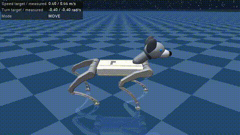
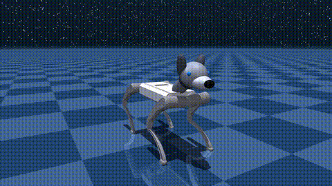

# Train a Dog with RL · 效果展示

让 Sieans 四足机器人在 MuJoCo 中站立、按指令调速、左右转弯、原地转弯，并完成四足离地的后空翻。这里公开展示最终效果；训练代码和策略模型保存在[需授权访问的项目仓库](https://github.com/Jianglin-Yan/Train-a-dog-with-RL)。所有展示均为仿真结果，尚未在真机上验证。

## 行走与转弯

[观看完整 80 秒演示（MP4）](media/locomotion.mp4) · 包含站立、变速直行、左右转弯与原地转弯。

## 后空翻

[观看完整后空翻演示（MP4）](media/backflip.mp4) · 四足起跳、空中向后旋转、落地站稳。

行走/转弯与后空翻由两个独立的强化学习策略控制。后空翻策略采用 PPO 训练，回放时使用落地阶段修正；本展示不包含 SuperMimic 训练成果。

## 申请访问项目

如需查看训练代码、模型或详细结果，请[提交访问申请](https://github.com/Jianglin-Yan/Train-a-dog-with-RL-showcase/issues/new?template=access-request.yml)。请使用自己的 GitHub 账号提交，简要说明用途；不要在公开 Issue 中填写密码、手机号或其他敏感信息。审核通过后，仓库维护者会通过 GitHub 发出邀请；接受邀请后即可访问私有仓库。
